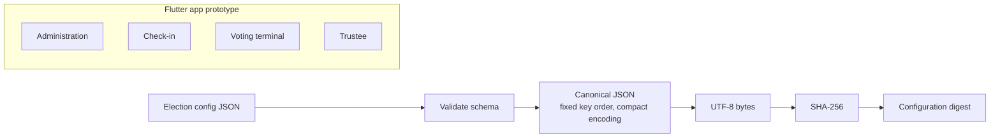

# DEVO

DEVO is an app-layer prototype exploring verifiable student elections. It has
four placeholder role workspaces and a Dart module that validates election
configuration and computes a deterministic SHA-256 digest; it has no on-chain
component yet.

## Current status

The administration, check-in, and trustee screens are placeholders. The voting
screen lets a user make and review local selections, but does not submit or save
them. The configuration module validates a JSON schema and hashes its
canonical representation. No Rust source, backend, voter eligibility system,
or deployed contract is present in this repository.

## Architecture



## Run

Install the Flutter SDK, then run from this directory:

```sh
flutter pub get
flutter run
```

## Test

```sh
dart format --output=none --set-exit-if-changed lib test
flutter analyze
flutter test
```

The digest is SHA-256 over compact JSON emitted in the schema's fixed field
order, encoded as UTF-8. JSON formatting and object-key order in the input do
not affect it; array order and string contents do. Numeric schema fields are
integers. Tests check a fixed digest vector independently calculated with
`shasum -a 256`, key-order/whitespace invariance, changed fields, and invalid
inputs.

## Screenshots

Add real screenshots under `docs/screenshots/` when available. Capture them
from a running app and use descriptive filenames; no screenshots are included
yet.

## Limitations

- Prototype only; not suitable for conducting a real election.
- No authentication, voter eligibility checks, NFC check-in, anonymous tokens,
  ballot submission, persistence, or election backend.
- No voter privacy or ballot security guarantees.
- No smart contract, blockchain/testnet integration, or deployment.
- SHA-256 configuration hashing alone does not make election data trustworthy
  or votes verifiable.

## Roadmap

1. Anchor the configuration digest on-chain through a future `ElectionAnchor`
   contract.
2. Design and implement voter eligibility checks.
3. Research privacy-preserving voting and define its security requirements.
